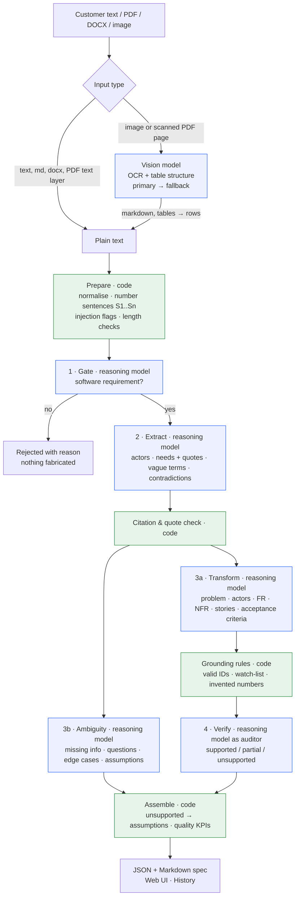

# Reqnova Architecture

Reqnova turns messy, conversational customer descriptions into structured software requirements **without inventing anything**. This document explains how the system is decomposed, where models are used, where plain code is used, and why.

## 1. Problem decomposition

Converting a customer description into a spec without inventing anything is split into questions that can each be checked separately:

| # | Question | Answered by | Why |
|---|---|---|---|
| 0 | What exactly did the customer say, sentence by sentence? | **Code** | Deterministic. Numbered sentences (`S1..Sn`) give every later step something concrete to cite. |
| 1 | Is this a software requirement at all? | **Reasoning model** (gate) | A semantic judgement. Rejecting early stops the system from inventing a spec for a non-software request. |
| 2 | Which facts are stated: actors, needs, vague words, contradictions? | **Reasoning model** + **code** check | The model understands paraphrase; code verifies every quote really appears in the cited sentence. |
| 3a | How do those facts become requirements, user stories and acceptance criteria? | **Reasoning model** (transformation) | Language generation constrained to the extracted facts. |
| 3b | What is missing, vague or risky? | **Reasoning model** (ambiguity analysis) | A separate task, so finding gaps never competes with writing requirements. |
| 4 | Is every requirement supported by the customer's words? | **Code** rules + **reasoning model** verifier | Rules catch known invention patterns; the verifier catches subtler additions. |
| 5 | Final shape, quality metrics, export | **Code** | Pure assembly. |

## 2. Architecture diagram

Blue nodes use a model. Green nodes are deterministic Python.

### Models

| Role | Used for | UI label |
|---|---|---|
| **Reasoning model, fast** | All pipeline steps by default | `Model_1` |
| **Reasoning model, deep** | All pipeline steps when selected; slower, more deliberate | `Model_2` |
| **Backup reasoning model** (optional) | Last-resort fallback if a call fails or times out | not shown |
| **Vision model** (primary + fallback) | Reading images and scanned PDF pages, including table structure | not shown |

Model IDs, endpoints and keys come only from `.env`. The UI, API responses and saved history show only the labels `Model_1` / `Model_2`.

## 3. Components

| File | Responsibility |
|---|---|
| `app/parser.py` | File → text. Routes by type; only images and scanned pages go to the vision model. LaTeX tables are converted to markdown rows. |
| `app/preprocess.py` | Normalise text, split into numbered sentences (table rows kept intact), detect prompt-injection phrases, check input length. |
| `app/prompts.py` | All prompts. A shared `GROUNDING_RULES` contract is injected into every pipeline prompt. |
| `app/llm.py` | Streaming client for any OpenAI-compatible endpoint, JSON extraction, Pydantic validation with one self-repair retry, rate-limit backoff, per-model deadlines and a fallback chain. |
| `app/schemas.py` | Pydantic contracts. Every claim carries `source_ids` and `origin ∈ {stated, implied, assumption}`. |
| `app/grounding.py` | Deterministic hallucination guards (§5). |
| `app/pipeline.py` | Orchestrator. Steps 3a and 3b run in parallel; emits progress events. |
| `app/history.py` | Saves every analysis to SQLite for the History tab. |
| `app/main.py` | FastAPI: file extraction, analysis streamed over Server-Sent Events, Markdown export, history. |
| `frontend/` | Vanilla HTML/CSS/JS, no build step. Live progress, origin/support badges, citation chips that highlight the source sentence, History tab, light/dark themes. |

## 4. Where and why a model is used

| Step | Why a model | How it is constrained |
|---|---|---|
| Vision | Customers send photos of whiteboards and scanned workshop tables; OCR has to keep table structure | PDFs with a text layer skip the model entirely. Extracted text goes back to the text box for **human review** before analysis. |
| Gate | Telling "send a plumber" apart from "nobody tells customers their repair is done" (a hidden software need) is semantic | Four classes with a visible reason |
| Extraction | Paraphrase, pronouns, mixed languages | Must copy, not design. Exact quotes are verified by code. |
| Transformation | Writing "The system shall…" and Given/When/Then | Sees only the numbered text and the extracted facts; must cite; `[TBD]` for unknown values |
| Ambiguity | Knowing that an attendance system needs a login method is domain reasoning | Separate call with a checklist; reports gaps, never fills them |
| Verifier | Spots subtle additions a word list misses | Its verdict is combined with rules, and rules can only downgrade it |

## 5. Where code and rules are used, and why

Models are good at language but cannot be trusted to police themselves. Everything that can be checked deterministically is checked in code:

1. **Sentence numbering.** Without IDs grounding can't be tested; with them, an uncited claim is detectable.
2. **Citation validation.** IDs that don't exist are stripped. A requirement left with no valid citation is **demoted to `assumption`**.
3. **Quote check.** Extracted quotes must appear in the cited sentence (≥80% fuzzy match), or the fact is dropped.
4. **Hallucination watch-list.** Terms models habitually add (biometric, GPS, SSO/OAuth, 2FA, SMS, file formats, uptime/SLA, compliance regimes, cloud vendors, payroll…). If one appears in a requirement but not in the input, the requirement is flagged and can't be marked "supported".
5. **Invented numbers.** Any number in a requirement that the customer never said is flagged.
6. **Prompt injection.** Customer text is wrapped in `<customer_input>` tags and declared to be data. A regex detector adds a visible warning.
7. **Input limits.** Fewer than 4 words → refuse. More than 20k chars → truncate with a warning.
8. **Schema validation.** Pydantic, with one self-repair retry that shows the model its own error.

## 6. How the components interact

* The browser POSTs `{text, mode}` to `/api/analyze`. The pipeline runs in a worker thread and streams `step` events and finally a `result` event over **Server-Sent Events**, with a keep-alive every 15 s.
* File uploads go to `/api/extract` first. The text lands in the editor so the analyst can **fix OCR mistakes before analysis**.
* Steps 3a and 3b depend only on the extraction, so they run **in parallel**.
* Verifier verdicts are applied in code: `unsupported` → removed from the requirements and added to *Assumptions to confirm* with the reason; `partial` → kept and flagged. Story links to removed requirements are cleaned up.
* Every finished analysis is saved to SQLite and appears in the **History** tab.

## 7. Key engineering decisions and trade-offs

| Decision | Alternative | Why / trade-off |
|---|---|---|
| Multi-step pipeline | One big prompt | Each step has one job and its own checks. Costs latency (5 calls instead of 1) but gives traceability and better gap detection. |
| Extract before transform | Generate requirements from raw text | Forces the model to commit to *what was said* before designing, and gives code quotes to verify. |
| Separate ambiguity step | Ask for gaps inside the requirements prompt | In a single prompt, gaps tended to be "resolved" by inventing answers. |
| `origin` labels | Allow only verbatim requirements | Logically necessary requirements stay visible and honestly labelled. |
| Rules + model verifier | Model judge only | Rules are deterministic and can't be persuaded; they can downgrade a verdict but never upgrade it. |
| `[TBD]` placeholders | Let the model pick defaults | Defaults are exactly the invented requirements the system must avoid. |
| Temperature 0.1 | Higher | Consistency matters more than creativity in a spec. |
| Two selectable reasoning models | One fixed model | The fast model gives interactive latency; the deep model is there when quality matters more than time. A fallback chain keeps runs alive when an endpoint is overloaded. |
| Human review of OCR text | Parse → analyse in one shot | An OCR error would become a requirements error; one click prevents it. |
| Vanilla JS + FastAPI | React / Streamlit | No build step, easy to read, clean per-step streaming. |
| Config only in `.env` | Hard-coded IDs/keys | Security and provider-independence; any OpenAI-compatible endpoint works. |

## 8. Known limitations

* Latency depends on the model endpoint; on shared free tiers a full analysis can take several minutes.
* The watch-list is English-only and finite; new invention patterns are left to the verifier.
* Sentence splitting is heuristic, so very long run-on sentences get coarse citations.
* History is single-user (no accounts). A public deployment would need authentication.
